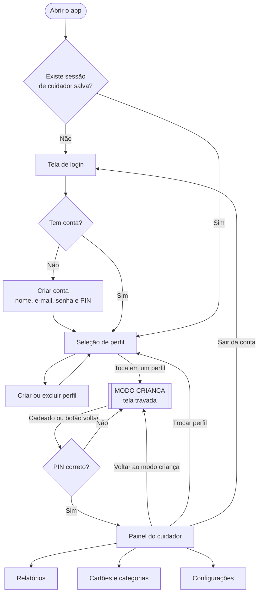
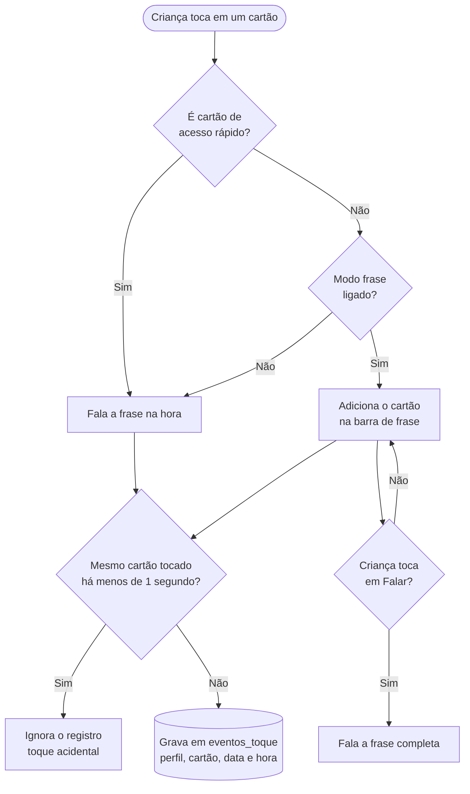
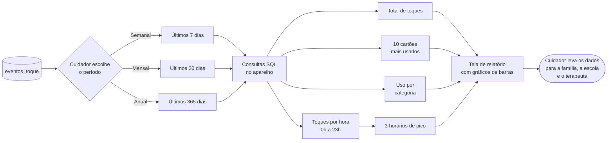
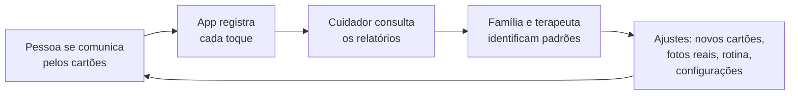
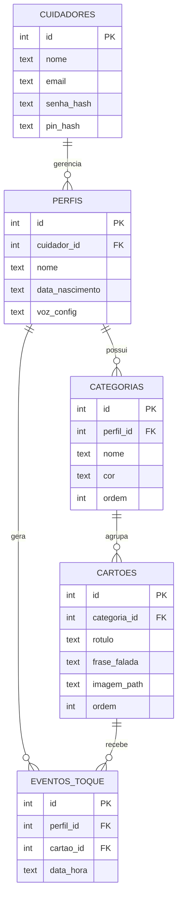

<div align="center">

# Voz em Imagens

**Comunicação Aumentativa e Alternativa (CAA) por imagens para pessoas autistas não verbais e com deficiência de comunicação**


</div>

---

## Sumário

1. [Sobre o projeto](#sobre-o-projeto)
2. [Base científica e oficial da CAA](#base-científica-e-oficial-da-caa)
3. [Funcionalidades](#funcionalidades)
4. [Fluxogramas do aplicativo](#fluxogramas-do-aplicativo)
5. [Como os relatórios ajudam na convivência](#como-os-relatórios-ajudam-na-convivência)
6. [Tecnologias e arquitetura](#tecnologias-e-arquitetura)
7. [Como executar](#como-executar)
8. [Autores](#autores)
9. [Referências](#referências)

---

## Sobre o projeto

O **Voz em Imagens** é um aplicativo de prancha de comunicação digital. A pessoa toca em um cartão com uma imagem (emoji ou foto real) e o app **fala a frase em voz alta**, em português do Brasil. Assim, quem não fala, ou fala pouco, consegue dizer o que precisa, o que sente e o que quer fazer.

O app tem dois modos:

- **Modo criança:** uma tela simples, travada e só com cartões grandes que falam ao toque.
- **Modo cuidador:** protegido por PIN. É onde pais, professores e terapeutas criam cartões, ajustam a voz e acompanham relatórios de uso.

Tudo funciona **100% offline**, e os dados ficam guardados apenas no aparelho.

---

## Base científica e oficial da CAA

O Voz em Imagens é uma ferramenta de **CAA assistida de alta tecnologia**, do tipo *dispositivo gerador de fala*. Essa abordagem é reconhecida por instituições de saúde, de pesquisa e pela legislação brasileira.

### 1. Prática baseada em evidências para autismo (NCAEP, 2020)
O *National Clearinghouse on Autism Evidence and Practice* (NCAEP), da Universidade da Carolina do Norte, revisou **972 estudos científicos** sobre intervenções para pessoas autistas de 0 a 22 anos. A **Comunicação Aumentativa e Alternativa** foi classificada como uma das **28 práticas baseadas em evidências**. Os **suportes visuais** e as **intervenções mediadas por tecnologia** também estão nessa lista, e o app usa os dois. O PECS (sistema de comunicação por troca de figuras), que inspirou as pranchas de imagens, também atende a todos os critérios de evidência.

### 2. American Speech-Language-Hearing Association (ASHA)
A ASHA, principal entidade de fonoaudiologia dos EUA, coloca o **transtorno do espectro autista** entre as condições em que a CAA é indicada. A entidade estima que cerca de **1,3% das pessoas** não conseguem se comunicar de forma confiável pela fala no dia a dia.

A ASHA também desmente um mito comum: **a CAA não atrapalha o desenvolvimento da fala.** Segundo a entidade, a CAA pode até *ajudar a melhorar a fala natural*. Em um estudo com crianças autistas minimamente verbais, o uso de um dispositivo gerador de fala **aumentou a fala espontânea** em comparação com a mesma intervenção sem o dispositivo.

### 3. Ministério da Saúde do Brasil
As **Diretrizes de Atenção à Reabilitação da Pessoa com Transtornos do Espectro do Autismo (TEA)**, publicadas pelo Ministério da Saúde em 2014, incluem a **Comunicação Suplementar e Alternativa (CSA)** entre as abordagens de cuidado orientadas às equipes multiprofissionais do SUS.

### 4. Lei Brasileira de Inclusão (Lei nº 13.146/2015)
A LBI reconhece os **recursos de comunicação aumentativa e alternativa** como forma legítima de comunicação (art. 3º, V). Ela também define **tecnologia assistiva** como produtos, recursos e práticas que promovem a funcionalidade e a inclusão da pessoa com deficiência (art. 3º, III). O Voz em Imagens se enquadra nessa definição.

> **Importante:** o Voz em Imagens é um **recurso de apoio**. Ele não substitui o acompanhamento de fonoaudiólogos e da equipe terapêutica. Os melhores resultados aparecem quando a CAA é usada dentro de um plano de intervenção, com a participação da família e da escola.

---

## Funcionalidades

### Modo criança
| Recurso | Descrição |
|---|---|
| **Cartões que falam** | Um toque e a frase é falada em pt-BR, com resposta quase imediata (meta de 300 ms). |
| **Acesso rápido** | Uma linha fixa com os cartões urgentes (*Banheiro, Água, Dor, Ajuda, Parar*), que estão sempre visíveis e falam na hora. |
| **Categorias coloridas** | Necessidades, Comida, Sentimentos, Atividades, Respostas e outras, cada uma com sua cor. |
| **Modo frase** | Os toques montam uma frase em uma barra, e a pessoa ouve a frase completa quando quiser. Isso estimula a combinação de ideias. |
| **Tela travada** | O botão voltar não sai do modo criança. Para sair, é preciso tocar no cadeado e digitar o PIN do cuidador. |

### Modo cuidador
| Recurso | Descrição |
|---|---|
| **Vários perfis** | Um cuidador pode gerenciar mais de uma criança, cada uma com seu vocabulário e suas configurações. |
| **Cartões personalizados** | Crie cartões com **fotos reais** tiradas pela câmera ou escolhidas na galeria, ou use emojis. Também dá para editar, ocultar e excluir cartões. |
| **Configurações** | Velocidade da voz, de 2 a 4 cartões por linha e modo frase ligado ou desligado. |
| **Relatórios de uso** | Total de toques, os 10 cartões mais usados, o uso por categoria e os horários de pico, em períodos semanal, mensal ou anual. |
| **Segurança** | A senha e o PIN nunca são gravados em texto simples. O app guarda apenas o hash SHA-256. |

---

## Fluxogramas do aplicativo

### 1. Navegação geral



### 2. O que acontece em cada toque

A voz sai primeiro. O registro no banco acontece logo depois, sem atrasar o som.



### 3. Como o relatório é gerado



### 4. Ciclo de uso dos dados

Os relatórios fecham um ciclo: a pessoa se comunica, o app registra, o cuidador observa e o vocabulário melhora.



### 5. Modelo de dados



---

## Como os relatórios ajudam na convivência

Quem não fala nem sempre consegue explicar *quando* e *com que frequência* sente algo. Cada toque no Voz em Imagens vira um dado com data e hora. Com o tempo, esses dados mostram padrões que a família, a escola e os terapeutas talvez não percebam no dia a dia.

### Por que esses dados importam

- **Comportamento também é comunicação.** Segundo a ASHA, muitos comportamentos considerados desafiadores na verdade servem a uma função comunicativa. Para reduzi-los, é preciso ensinar outra forma de alcançar o mesmo objetivo. A *Comunicação Funcional* (FCT) é uma prática baseada em evidências que faz exatamente isso. Quando o relatório mostra que a criança usa o cartão "Parar" ou "Ajuda", o cuidador vê a necessidade sendo expressa por um meio adequado, e não por uma crise.
- **A dor de quem não fala costuma passar despercebida.** Uma revisão científica de 2023 mostrou que crianças autistas correm mais risco de ter a dor mal manejada, porque relatam menos a dor verbalmente. A mesma revisão recomenda apoio por imagens. O cartão "Dor" fica sempre visível no acesso rápido, e o relatório mostra quantas vezes e em que horários ele foi usado.
- **A CAA exige acompanhamento contínuo.** A ASHA descreve a avaliação em CAA como um processo contínuo, que inclui coleta de dados e ajustes do sistema conforme as necessidades mudam. A entidade também diz que a família é parte essencial do processo, e que a falta de envolvimento da família é um dos principais motivos de abandono do dispositivo. Os relatórios dão à família dados concretos para levar às consultas.

### O que cada dado pode revelar

| Dado do relatório | Exemplo de leitura | Como pode ajudar na convivência |
|---|---|---|
| **Cartões mais usados** | "Água" e "Banheiro" estão no topo da semana. | Mostra as necessidades mais frequentes. A família pode antecipá-las e deixar água sempre acessível, por exemplo. |
| **Uso de "Dor"** | "Dor" foi tocado 6 vezes no mês, quase sempre à noite. | Dá um sinal objetivo para levar ao pediatra ou ao dentista, em vez de depender só da observação do comportamento. |
| **Uso de "Parar" e "Ajuda"** | "Parar" aparece muito por volta das 14h. | Pode apontar uma atividade ou ambiente que gera sobrecarga naquele horário. A rotina pode ser revista com a escola. |
| **Uso por categoria** | Sentimentos cresce, Atividades cai. | Ajuda a acompanhar o estado emocional ao longo das semanas e a conversar sobre isso com a equipe terapêutica. |
| **Horários de pico** | Maior uso às 7h, 12h e 19h. | Mostra os momentos em que a comunicação é mais necessária. O tablet pode ficar à mão nesses horários. |
| **Total de toques por período** | Os toques aumentaram do mês passado para este. | Indica se a pessoa está adotando a ferramenta. Uma queda pode sinalizar que o vocabulário precisa de cartões novos ou mais significativos. |
| **Cartões pouco usados** | Um cartão nunca aparece no ranking. | Pode ser trocado por uma foto real do objeto, renomeado ou ocultado para simplificar a prancha. |
| **Comparação semanal, mensal e anual** | Necessidades estáveis o ano todo, Sentimentos mais alto em período de provas. | Permite enxergar mudanças de longo prazo e avaliar o efeito de mudanças na rotina ou na terapia. |

> Os relatórios mostram **apenas dados de uso do aplicativo**. Eles não são diagnóstico nem avaliação clínica. O app exibe esse aviso na própria tela de relatórios e orienta o cuidador a levar os dados ao profissional que acompanha a criança.

---

## Tecnologias e arquitetura

- **[Flutter](https://flutter.dev/) / Dart**: interface multiplataforma com Material 3.
- **sqflite**: banco de dados SQLite local, para uso offline.
- **flutter_tts**: síntese de voz em português (pt-BR).
- **image_picker** e **path_provider**: fotos dos cartões.
- **shared_preferences**: sessão do cuidador.
- **crypto**: hash de senha e PIN.

O projeto segue o padrão **MVC**:

```
lib/
├── controllers/   # Regras de negócio (auth, perfis, cartões, toques, relatórios)
├── database/      # Banco SQLite e vocabulário inicial
├── models/        # Cuidador, Perfil, Categoria, Cartão, Relatório, ConfigVoz
├── services/      # VozService (síntese de voz pt-BR)
├── utils/         # Cores, formatação e segurança
├── views/         # Telas (login, perfis, comunicação, painel do cuidador...)
└── widgets/       # Componentes reutilizáveis (cartão, barra de frase...)
```

---

## Como executar

**Pré-requisitos:** [Flutter SDK](https://docs.flutter.dev/get-started/install) (Dart 3.4 ou superior) e um emulador ou aparelho Android/iOS.

```bash
git clone https://github.com/hyoyami/voz-em-imagens.git
cd voz-em-imagens
flutter pub get
flutter run
```

> **Dica:** no Android, para a voz funcionar, o aparelho precisa ter o **Google Text-to-Speech** com a voz em **português (Brasil)** instalada.

### Testes
```bash
flutter test
```
Os testes cobrem o hash de senha e PIN, os períodos dos relatórios, a ordenação dos horários de pico, a identificação de cartões de emoji e a serialização das configurações.

---

## Autores

Projeto desenvolvido em parceria por:

| [<br>**Guilherme Augusto**](https://github.com/hyoyami) | [<br>**Kauã Rocha**](https://github.com/ImTogs) |
|:---:|:---:|

---

## Referências

1. STEINBRENNER, J. R. et al. **Evidence-based practices for children, youth, and young adults with autism.** National Clearinghouse on Autism Evidence and Practice (NCAEP), University of North Carolina at Chapel Hill, 2020. Disponível em: <https://ncaep.fpg.unc.edu/wp-content/uploads/EBP-Report-2020.pdf>
2. NCAEP. **Frequently Asked Questions About the NCAEP Report.** 2020. Disponível em: <https://ncaep.fpg.unc.edu/?p=780>
3. AMERICAN SPEECH-LANGUAGE-HEARING ASSOCIATION (ASHA). **Augmentative and Alternative Communication – Practice Portal.** Disponível em: <https://www.asha.org/practice-portal/professional-issues/augmentative-and-alternative-communication/>
4. ASHA. **Autism and Communication Skills: Addressing Misconceptions With Scientific Facts.** Disponível em: <https://www.asha.org/practice/autism-and-communication-skills-misconceptions-versus-facts/>
5. ASHA – National Joint Committee for the Communication Needs of Persons With Severe Disabilities. **Challenging Behavior as Communication.** Disponível em: <https://www.asha.org/njc/challenging-behavior-as-communication/>
6. JOHNSON, E.; VAN ZIJL, K.; KUYLER, A. **Pain communication in children with autism spectrum disorder: A scoping review.** *Paediatric and Neonatal Pain*, v. 5, n. 4, 2023. DOI: <https://doi.org/10.1002/pne2.12115>
7. BRASIL. Ministério da Saúde. **Diretrizes de Atenção à Reabilitação da Pessoa com Transtornos do Espectro do Autismo (TEA).** Brasília: Ministério da Saúde, 2014. Disponível em: <https://bvsms.saude.gov.br/bvs/publicacoes/diretrizes_atencao_reabilitacao_pessoa_autismo.pdf>
8. BRASIL. **Lei nº 13.146, de 6 de julho de 2015.** Lei Brasileira de Inclusão da Pessoa com Deficiência. Disponível em: <https://www.planalto.gov.br/ccivil_03/_ato2015-2018/2015/lei/l13146.htm>
9. BRASIL. **Lei nº 12.764, de 27 de dezembro de 2012.** Política Nacional de Proteção dos Direitos da Pessoa com Transtorno do Espectro Autista. Disponível em: <https://www.planalto.gov.br/ccivil_03/_ato2011-2014/2012/lei/l12764.htm>

---

<div align="center">

Feito para que toda pessoa tenha voz.

</div>
